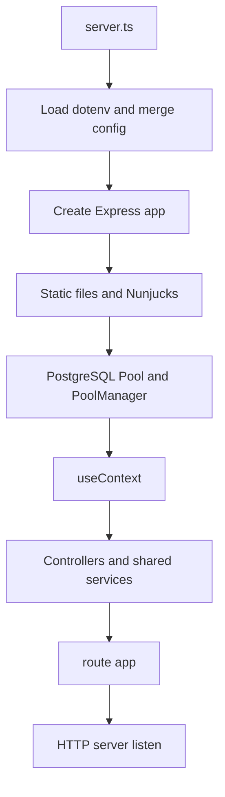
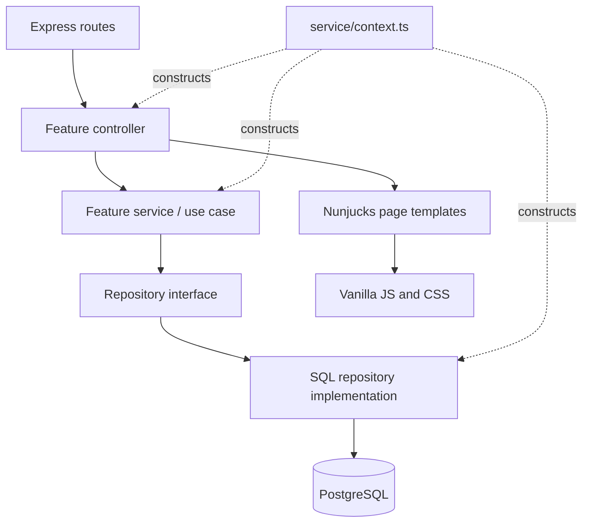

# Architecture

## Technology and runtime

| Concern              | Implementation in this repository                                                   |
| -------------------- | ----------------------------------------------------------------------------------- |
| Language             | TypeScript (`strict: true`)                                                         |
| HTTP server          | Express 5                                                                           |
| Database             | PostgreSQL via `pg` and `postgres-kit`                                              |
| Database abstraction | `onecore` DB/transaction interfaces and `sql-core` repositories/search builders     |
| HTML rendering       | Nunjucks templates (`views/`)                                                       |
| Browser behavior     | Vanilla JavaScript under `public/static/`                                           |
| Authentication       | `authen-service`, JWT (`jsonwebtoken` / `express-jsonwebtoken`), `security-express` |
| Validation           | `validation-core`, `types-validation`                                               |
| Build                | Webpack + `ts-loader`                                                               |
| Logging / health     | `logger-core`, `express-web-kit`                                                    |

There is no Next.js, React, or client-side component framework in the inspected package manifest/source tree. The existing `server.js` is a generated Webpack bundle, not a Next.js output directory.

## Runtime composition

Key files:

- `server.ts`: loads environment settings, creates the Express app, serves `public/`, configures Nunjucks, creates the PostgreSQL pool/`PoolManager`, builds the application context, registers routes, and starts the HTTP server.
- `config.ts`: default application, database, authentication, logging, middleware, and SQL configuration. Do not treat embedded fallback secrets as production secrets.
- `service/context.ts`: composition root. `useContext()` creates shared infrastructure and each feature controller, then returns the `Context` consumed by routes.
- `service/index.ts`: central route table and authorization middleware attachment.
- `service/template.ts`: shared Nunjucks rendering, formatting helpers, and error rendering.

## Layering

The feature's `<feature>.ts` file normally declares both the domain contracts and the repository/service interfaces. The repository implementation depends on the `onecore` DB abstraction, not directly on an HTTP request. The controller depends on the service interface, not on SQL.

The `index.ts` in each feature is a small composition function (for example, `useCategoryController(db)`). This keeps construction details out of controllers and centralizes dependencies in `service/context.ts`.

## Request lifecycle

1. Express receives a request through the route registered in `service/index.ts`.
2. Protected routes pass through `ctx.authorize(moduleId, permission)`.
3. Page routes generally call `ctx.menu.build` to populate the menu and authenticated request context.
4. The feature controller reads request parameters/body and localization from `getLang()` / `getResource()`.
5. Controllers call the feature service. Services apply domain rules and call repository contracts.
6. SQL repositories use `DB.query`, `DB.execute`, or a `sql-core` repository/search abstraction.
7. For HTML responses, controllers call `render()` from `service/template.ts`; JSON actions use Express response methods.
8. The browser uses `navigate(event)` for partial-page navigation and existing form helpers for submissions.

Login routes are separate from the protected feature routes. `/health`, `/log`, and `/middleware` are infrastructure/configuration routes.

## Feature inventory

| Feature folder   | Main responsibility                                           | Tables / external concepts visible in source               |
| ---------------- | ------------------------------------------------------------- | ---------------------------------------------------------- |
| `authentication` | Login rendering and authentication                            | `users`, `passwords`; `authen-service`, JWT                |
| `user`           | User search, details, role assignment                         | `users`, `user_roles`                                      |
| `role`           | Role search, details, privilege assignment, user assignment   | `roles`, `role_modules`, `user_roles`, `modules`           |
| `audit-log`      | Search audit records                                          | `audit_logs`                                               |
| `category`       | Category CRUD                                                 | `categories`                                               |
| `content`        | Language-specific content CRUD                                | `contents`                                                 |
| `article`        | Draft, submit, approve/reject, history, notifications         | `draft_articles`, `articles`, `histories`, `notifications` |
| `job`            | Job CRUD and slug handling                                    | `jobs`                                                     |
| `contact`        | Contact submission management                                 | `contacts`                                                 |
| `shared`         | Reusable adapters, status helpers, shared user/role contracts | `histories`, `notifications`, `user_roles`                 |

The repository archive does not include a migrations/seeds directory. Table shapes should be checked against the actual database DDL before schema changes.

## Rendering model

The application is server-rendered with Nunjucks:

- `views/layout.html` is the outer page shell.
- `views/pages/*.html` are feature pages included by the layout.
- `views/partials/*.html` contain shared UI fragments.
- `service/template.ts` compiles the requested page template and injects formatting helpers and `res.locals.menu`.

The browser then swaps the `#pageBody` content for navigation requests marked `partial=true`. This is a lightweight partial-navigation pattern, not a Next.js router or SPA framework.

## Important implementation characteristics

- Nunjucks `autoescape` is explicitly disabled in `server.ts`; controllers must escape user-controlled values before rendering.
- `useContext()` is the composition root; avoid creating database pools or global service instances in individual features.
- Authorization is server-side and route-based. Hiding UI actions is only a presentation concern, not access control.
- Articles demonstrate explicit transaction use and shared history/notification adapters.
- The TypeScript build uses `module: nodenext`, `moduleResolution: nodenext`, `target: es6`, and strict checking.
